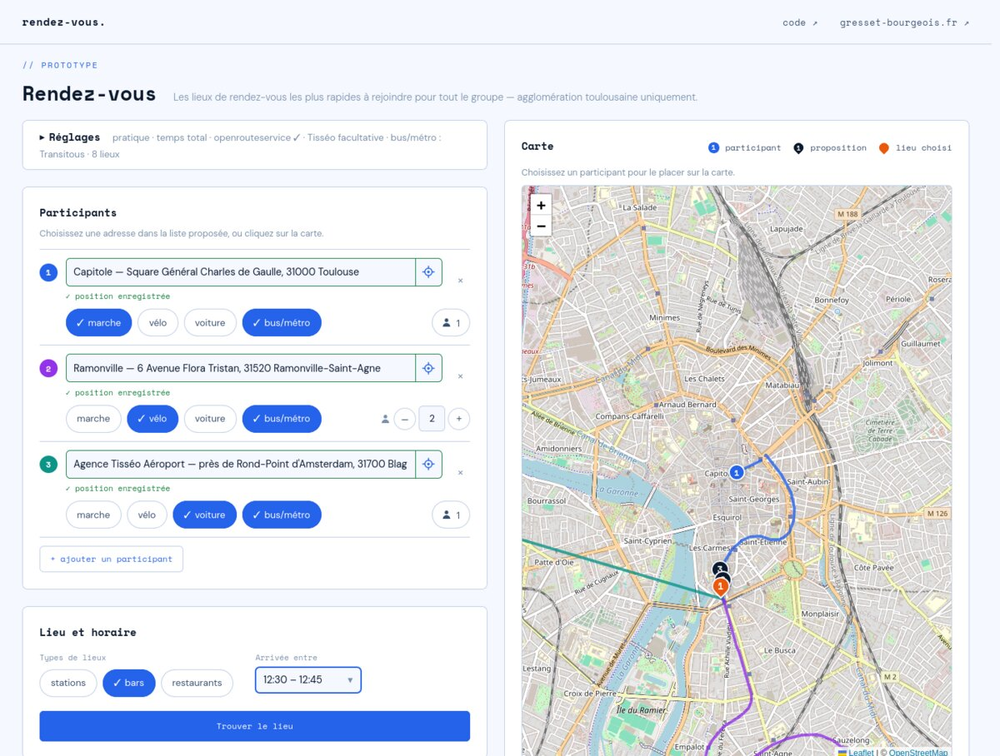

# Rendez-vous

Where should a group meet? Rendez-vous takes each person's starting point and how they travel
(walking, cycling, driving, public transport), and proposes 3 stations, bars, cafés or restaurants of
the Toulouse area that everyone can reach in a comparable time, for a chosen meeting time.

It is a decision aid, not a decision maker: the group still weighs habits, prices and the rest.

**Try it:** [rendez-vous.gresset-bourgeois.fr](https://rendez-vous.gresset-bourgeois.fr) (French
interface, Toulouse area only). A project by [Nicolas Gresset-Bourgeois](https://gresset-bourgeois.fr).



## How it works

1. **Candidates**: 8 places of the chosen kinds at least 700 m apart, around the participants' weighted
   barycenter, taken from a local file of about 17,400 Toulouse places built from OpenStreetMap and
   the Tisséo GTFS feed.
2. **Travel times**: walking, cycling and driving times from
   [openrouteservice](https://openrouteservice.org) (one matrix request per mode), public transport
   journeys from the Tisséo API or, optionally, [Transitous](https://transitous.org). A journey may arrive
   up to 10 min after the meeting time; arriving before it counts as waiting.
3. **Score**: "équitable" by default, the mean time plus half the excess of the longest trip over the
   mean, or "égalitaire", the mean time per person. The 3 best places are shown with each person's
   journey, step by step.

Everything runs in the browser, but for two small Vercel Functions (`api/`) that relay the openrouteservice
and Tisséo calls with the author's keys, for a trial until 2026-11-08: visitors enter no key. Addresses are completed
instantly from the local file, then by the French IGN Géoplateforme.

The full pipeline, with diagrams, API calls, quotas and data sources, is in
[docs/pipeline.md](docs/pipeline.md); how the proposals were measured against the best places of the
whole file is in [docs/evaluation.md](docs/evaluation.md).

## Status

A working prototype. With a local [MOTIS](https://github.com/motis-project/motis) server, the page
already runs a better method, not available online yet: it estimates zones of nearby places all over
the area, computes exact times for the best ones, and proposes the best place of 3 distinct zones.

Next: a home server exposing these routing services, so that the method goes online and visitors need
no key, then deciding what can be cached, and in the longer run a home-made routing engine.

## Running it locally

No build step, no dependency: vanilla HTML, CSS and JavaScript modules, with
[Leaflet](https://leafletjs.com) served from `assets/vendor/`.

```sh
node scripts/dev-server.js    # http://localhost:3001
```

The dev server applies the clean URLs and the Content-Security-Policy of `vercel.json`, and runs the functions of
`api/` with `OPENROUTESERVICE_API_KEY` and `TISSEO_API_KEY` from `.env` (on Vercel: its project settings). With a local MOTIS on port
8080 (setup in [docs/evaluation.md](docs/evaluation.md)), the page also offers it as an engine, which needs no key.

Tests (not deployed; the site itself still has no dependency and no build step):

```sh
npm ci                                        # ESLint and Playwright, development only
npx playwright install firefox                # with: chromium --only-shell, for the phone tests
npm test                                      # lint, unit tests (tests/unit), browser tests (tests/e2e)
```

They make no API call: the browser tests replay a recorded computation. On GitHub
(`.github/workflows/ci.yml`) every push runs them, on a phone-sized Safari too; Vercel's Deployment Checks hold
production until they pass (jobs `lint-and-unit` and `browser-tests`).

Development scripts (not deployed):

- `scripts/location-fixture.js shot`: replays a recorded computation in headless Firefox, without any
  API call, and screenshots the results (`scripts/firefox-bidi.js` drives Firefox).
- `scripts/search-queries.js [query…]`: rankings of the local address search for reference queries.
- `scripts/regenerate-places.sh`: rebuilds `data/pois-toulouse.json` from scratch (downloads, osmium,
  `scripts/build-places.js`, then `scripts/build-zones.js`, which needs MOTIS).
- `scripts/eval/`: the measures of `docs/evaluation.md`, on fixed test groups (needs MOTIS).

## Layout

```
index.html, legal.html   the tool, and its legal notice and privacy page
api/                     ors.mjs, tisseo.mjs (Vercel Functions: relays holding the keys)
js/                      engine.js (candidates, scoring), ors.js, transitous.js, tisseo.js (routing),
                         motis.js, debug-motis.js, debug-view.js (local MOTIS: method by zones, debug view),
                         search.js, geocode.js, autocomplete.js (address search), keys.js (settings in localStorage),
                         cancel.js (stale work), main.js (settings, computation, results),
                         participants.js, progress.js, map.js, results.js, slots.js, labels.js (interface)
css/                     base.css (shared), rendez-vous.css, legal.css, fonts.css
data/                    pois-toulouse.json (places), tisseo-area.json (build input), README.md (sources)
docs/                    pipeline.md (a computation, end to end), evaluation.md (measures)
scripts/                 dev server, recorded computation, places build, eval/ (measures)
tests/                   unit/ (Node's test runner), e2e/ (Playwright)
```

## Privacy

No account, no cookies, no analytics. The browser sends the participants' positions to the routing
services listed above, and what is typed in an address field to the IGN Géoplateforme; details in
[legal.html](legal.html).

## Licences

- Code: [MIT](LICENSE).
- `data/pois-toulouse.json`: [ODbL 1.0](https://opendatacommons.org/licenses/odbl/1-0/), derived from
  © OpenStreetMap contributors and © Tisséo data, with addresses from the Base Adresse Nationale
  (see [data/README.md](data/README.md)).
- Fonts DM Sans and Space Mono: SIL Open Font License (`assets/fonts/`); Leaflet: BSD 2-Clause
  (`assets/vendor/leaflet/LICENSE`).
