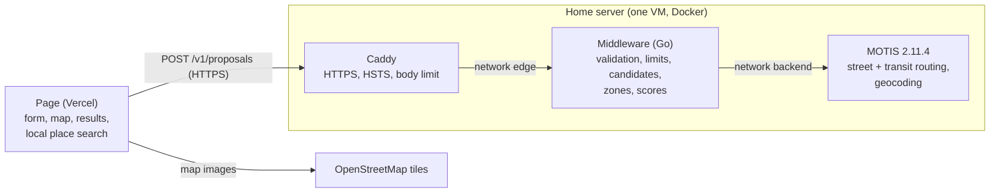

# Rendez-vous — target architecture and its decisions

The reference for how the service is being moved from the browser to a self-hosted server, and why each
choice was made. It records decisions as they are taken (from 2026-11-07); `docs/pipeline.md` describes
what runs today, and is updated as each part goes live. The machine itself (virtualization, firewalls,
remote access, backups) is documented in a private repository: this file only states what the service
needs from it.

## Status (2026-11-07)

| Part | State |
|---|---|
| Server reachable in HTTPS at `api.rendez-vous.gresset-bourgeois.fr` | Done: Caddy forwards `/v1/*` to the middleware (HSTS, 413 beyond 16 KB, 404 elsewhere); from 5G: ~50 ms to connect, ~200 ms for a first request |
| MOTIS (routing engine) on the server, not exposed | Done: tested from inside |
| Middleware (Go), `middleware/` | Skeleton deployed and tested from outside (2026-11-07): `GET /v1/health`, CORS, request log, image (4 MB to download) built by CI; `POST /v1/proposals` validates the question; places file, MOTIS client, score and method by zones checked against the page, the answer with street paths, errors 503 / 504, the limits per client and for the service (2026-11-08), `POST /v1/place`; **deployed** (2026-11-08, image `a92fbe0`): first real question from outside (3 participants, bars, Sunday 19:00) answered in 1.64 s with the network, 5 KB transferred (zstd) |
| The page calling the middleware | Not started: next (to discuss) |
| Automatic timetable (GTFS) update | Designed, postponed: **needed before 2026-12-02** |
| Load test of the whole chain | To do once the middleware exists |

## Overview

Today all the logic runs in the browser, which calls openrouteservice, Transitous or Tisséo and the IGN
Géoplateforme directly (`docs/pipeline.md`). The target: the page sends one request with the
participants, the server does all the work and answers the proposals.



- **Page** (static, on Vercel): the form, the map, the results, and the instant local search of places
  (`data/pois-toulouse.json`). No routing, no scoring.
- **Caddy**: the only exposed component (TCP 443), terminates HTTPS with a Let's Encrypt certificate and
  forwards `/v1/*` to the middleware.
- **Middleware**: validates the request, applies the limits, picks candidates with the precomputed zones,
  calls MOTIS, computes the score, answers.
- **MOTIS**: street times (walk, bike, car), transit journeys, geocoding; reachable only by the middleware.

## Decisions

Each entry: what was decided, the options considered, and why.

### All the logic leaves the browser (2026-11-07)

- Options: (A) a filtering relay in front of MOTIS, the page keeping candidates, zones and scores; (B) a
  middleware answering one request.
- Chosen: **B**. One network call instead of dozens (each ~35 ms from a phone on 4G), a single route to
  validate instead of part of the MOTIS API, and the target architecture already stated in `CLAUDE.md`.
  No progress streaming: the method by zones took ~0.2 s with a local MOTIS on a 16-core PC
  (`docs/evaluation.md`), so one answer is enough.
- Later, possible: sending each participant's position as soon as it is entered, so that part of the work
  is done before the button is pressed. It needs a session id, positions kept briefly in memory, and the
  visitor's consent (`legal.html`), since positions would leave before any click.

### The middleware is written in Go (2026-11-07)

- Options: JavaScript on Node (reuses `engine.js`, `debug-motis.js`, their tests and `scripts/eval`),
  Python (FastAPI and pydantic), Go, Rust.
- Chosen: **Go**. The middleware orchestrates more than it computes, so its speed matters little; Go gives
  a single static binary in a tiny image, an HTTP server and JSON in its standard library, strict types
  for validating input, and simple concurrency for the many parallel calls to MOTIS. JavaScript was ruled
  out by the author, who does not master it; rewriting also lets `scripts/eval` measure the deployed API.
- A home-made routing engine, if one is written, is a separate service in the language that suits it.

### Zones stay precomputed offline

`scripts/build-zones.js` builds them once (walking times from MOTIS) into the places file. The middleware
loads that file at start-up and only *uses* the zones at each request (estimate every zone, exact times
for the best, 3 distinct zones, then their places: `docs/evaluation.md` § Zones).

### One score (2026-11-08)

- First decided (2026-11-07): no score in the request, both scores (équitable, égalitaire) derived from one
  computation, the zone shortlist being the union of each score's.
- Then (decided by the user 2026-11-08): **only the équitable score** (the mean time per person plus half of what the
  longest trip has more). One score is more intuitive: it says the question was thought through and this is the best
  way to rank, without asking a newcomer to pick a metric. Another score may come back later, deliberately. The page
  is to lose its score setting.

### API contract (2026-11-07)

`POST /v1/proposals` (versioned path, so the format can change without breaking open pages):

```json
{
  "meetingTime": "2026-11-09T19:00",
  "placeType": "bar",
  "participants": [
    { "lat": 43.6045, "lon": 1.4442, "modes": ["walk", "transit"], "people": 1 },
    { "lat": 43.5557, "lon": 1.4746, "modes": ["bike"], "people": 2 }
  ]
}
```

No string from the user is trusted: every field is typed, bounded or taken from a closed list, and anything
else is refused with a `400` carrying a fixed error code (`{"error": "invalid_time"}`), never echoing the input.
Implemented in `middleware/validate.go` (2026-11-07): the body must be `application/json` (so browsers always send a
preflight), is read through a 16 KB limit, decoded refusing unknown fields and anything after the first value, then
turned into typed values (time in Toulouse's zone, the time zone database built into the binary). Error codes:
`unsupported_media_type` (415), `body_too_large` (413), `invalid_json`, `invalid_time`, `time_out_of_range`,
`invalid_place_type`, `invalid_participants`, and, with `"participant": <index>` so that the page can point at the
card, `invalid_position`, `outside_area`, `invalid_modes`, `invalid_people` (400). A meeting time up to 15 min in the
past is accepted (the page offers the quarter hour already begun); until the end of the imported timetable is known,
at most 30 days ahead. Go's decoder matches field names regardless of case (`MEETINGTIME` is accepted): harmless,
the value still goes through the same checks. A valid question gets `501 not_implemented` until the computation exists.

| Field | Rule |
|---|---|
| `meetingTime` | Exactly `YYYY-MM-DDTHH:MM`, Toulouse time (the server handles daylight saving), minutes 00, 15, 30 or 45, between now and the end of the imported timetable |
| `placeType` | `station`, `bar`, `cafe` or `restaurant` |
| `participants` | 2 to 10 |
| `lat`, `lon` | Finite numbers inside the Tisséo area (the OpenStreetMap extract: longitude 1.10–1.72, latitude 43.32–43.85) |
| `modes` | Non-empty, no duplicate, among `walk`, `bike`, `car`, `transit` |
| `people` | Integer, 1 to 15 |
| Anything else | Unknown fields refused; body at most 16 KB |

The answer (decided 2026-11-08, `middleware/answer.go`) is complete, so that the page needs no file to show it, and
indirect: places and zones in tables, the proposals as indices into `places`.

| Field | Content |
|---|---|
| `meetingTime` | As asked |
| `proposals` | Each kept zone's best place, best first (indices into `places`) |
| `zones` | The kept zones: `name`, `kind`, `places` (their scored places, best first, indices into `places`), `others` (the zone's places without times: name, category, position; scored when chosen, by a later route) |
| `places` | `name`, `category`, `lat`, `lon`, `zone` (index into `zones`, absent for a station), `score` (seconds, lower is better), `trips` |
| `trips` | One per participant, in the question's order: `mode` (the fastest), `seconds` (scored: with transit, the wait until the meeting time when arriving early), `travel` (shown: door to door), `departure` and `arrival` (transit only), `legs` |
| `legs` | `mode` (MOTIS's: `WALK`, `BIKE`, `CAR`, `BUS`, `SUBWAY`, `TRAM`…), `from`, `to`, `departure`, `arrival`, `path` (as MOTIS encodes it: Google's polyline and its precision), and for a line `line`, `headsign`, `color` (`#RRGGBB` only), `stops` |
| `data` | The places file's source dates and the first digits of its SHA-256 |

Street paths (walk, bike, car) come with **every scored place** (decided by the user 2026-11-08: any scored place shows
at once; one call per participant whose fastest mode there is a street one; a path MOTIS cannot give leaves `legs`
empty, as the page today). Measured 2026-11-08 (16-core PC, local MOTIS, groups T1 and Q3 of the evaluation, walk +
transit or car, bike, walk + transit, bars, restaurants, stations): at most 28 street paths, **15–70 ms**; the answer
**8–213 KB raw, 3–18 KB with gzip** (mostly the journeys' encoded paths), so Caddy compresses the answers (`encode zstd gzip`).

A simple example: two participants, bars, one zone shown of three, one place of it scored, another not (paths cut):

```json
{
  "meetingTime": "2026-11-10T19:00",
  "proposals": [0, 2, 4],
  "zones": [
    { "name": "Carmes", "kind": "bar", "places": [0, 1],
      "others": [ { "name": "Le Filochard", "category": "amenity=bar", "lat": 43.5951, "lon": 1.4446 } ] }
  ],
  "places": [
    { "name": "Le Bar Basque", "category": "amenity=bar", "lat": 43.5960, "lon": 1.4449, "zone": 0, "score": 1185,
      "trips": [
        { "mode": "transit", "seconds": 1260, "travel": 1140,
          "departure": "2026-11-10T17:39:00Z", "arrival": "2026-11-10T17:58:00Z",
          "legs": [
            { "mode": "WALK", "from": "START", "to": "Jean Jaurès", "departure": "2026-11-10T17:39:00Z",
              "arrival": "2026-11-10T17:44:00Z", "path": { "points": "…", "precision": 7 } },
            { "mode": "SUBWAY", "from": "Jean Jaurès", "to": "Carmes", "departure": "2026-11-10T17:44:00Z",
              "arrival": "2026-11-10T17:52:00Z", "line": "B", "color": "#FFCD00", "stops": 3, "path": { "points": "…", "precision": 7 } },
            { "mode": "WALK", "from": "Carmes", "to": "END", "departure": "2026-11-10T17:52:00Z",
              "arrival": "2026-11-10T17:58:00Z", "path": { "points": "…", "precision": 7 } } ] },
        { "mode": "bike", "seconds": 960, "travel": 960,
          "legs": [ { "mode": "BIKE", "departure": "…", "arrival": "…", "path": { "points": "…", "precision": 7 } } ] }
      ] }
  ],
  "data": { "sources": { "osm": "2026-10-28", "gtfs": "2026-11-02", "addresses": "2026-11-02" }, "sha256": "4f2a9c1e07b3" }
}
```

(Here the first participant arrives at 18:58, 2 min early: `seconds` counts those 2 min, `travel` does not. The score:
the mean (1260 + 960) / 2 = 1110, plus half of what the longest trip has more, (1110 + 1260) / 2 = 1185.)

Errors of the computation (decided 2026-11-08): MOTIS failing after its retry, `503 engine_unavailable`; the 25 s
deadline passed, `504 timeout` (decided by the computation's own deadline, whatever call hit it); nobody can reach
any place, `200` with empty lists; a visitor who left gets nothing (their calls stop).

Every place, scored or not, carries its `id` (the OpenStreetMap or GTFS id of the places file), to name it in the
second route.

**`POST /v1/place`** (decided by the user 2026-11-08, option A of three: computing every member of the kept zones at
once would mean up to 86 restaurants instead of 15, and not offering them would drop a wanted feature): the trips to
one other place of a kept zone, chosen in the page, since the proposals compute at most 5 places of a zone (the
limit decided 2026-11-03). The body is the question plus `"place": "<id>"`; the id (64 characters at most) is only
looked up among the candidates loaded, and must be a place of a zone of the type asked, else `400 invalid_place`. The
answer: `{"place": {id, name, category, lat, lon, reachable, score, trips}, "data"}`; unlike a proposal, someone may
not reach the place: then `reachable` is false, `score` absent and that participant's trip `null`. Same validation,
deadline, errors and computations at once as the proposals, but its own quotas per client: 30 a minute, 300 a day
(a visitor may look at several places in a row). Measured from outside on the server (2026-11-08, 3 participants, restaurants): the proposals 2.67 s, 7.6 KB; one other place 0.22 s, 1.7 KB.


### Security of the API (2026-11-07)

The API is public: anyone can call it, not only the page. The threats considered: abuse (saturating the
machine), crafted input, leaking personal data (positions, IP addresses), a compromised container used to
reach further.

| Threat | Protection |
|---|---|
| Abuse by one client | **5 computations a minute and 100 a day** per client (a computation = one `POST /v1/proposals`, the whole chain), counted per IPv4 address and per **IPv6 /64** (one subscriber has a whole /64, so per address would be trivial to bypass); a `429` with the delay, shown as a clear message in French |
| Saturation, even by legitimate users | **At most 4 computations at once**; a request finding them busy waits up to ~5 s, then gets a `503` with a delay; timeouts on each computation and each MOTIS call. A daily ceiling for the whole service: to decide after the load test |
| Huge or slow requests | Body ≤ 16 KB (Caddy and Go), header read timeouts |
| Crafted input | The strict contract above; JSON decoding refusing unknown fields; errors expose nothing internal |
| Another site using visitors' browsers | CORS allowing only `https://rendez-vous.gresset-bourgeois.fr` (CORS protects visitors, not the server: `curl` ignores it) |
| Interception | HTTPS (TLS encrypts the path, query, headers and body; an observer sees only the IP addresses, the host name, timing and sizes), HSTS; positions sent by `POST`, so they never sit in URLs or access logs |
| Reaching MOTIS from the front | Two Docker networks: `edge` (Caddy–middleware) and `backend` (middleware–MOTIS); Caddy cannot reach MOTIS |
| A compromised container | Minimal image (the Go binary alone, no shell), non-root user, read-only file system, no Linux capability, memory limit |

- Implemented 2026-11-08 (`middleware/limits.go`): the client is the last address of `X-Forwarded-For` (set by Caddy
  from the connection; only Caddy reaches the middleware), an IPv4 address or an IPv6 /64, an IPv4 address written as
  IPv6 counted as IPv4; requests without a readable address share one count. Rolling windows: at most 5 computations
  in 60 s and 100 in 24 h, counted when a valid question starts computing (an invalid one costs nothing; one refused
  as busy is not counted). Refused: `429 {"error": "rate_limited", "retryAfter": s}` and a `Retry-After` header, the
  wait being until the oldest computation leaves the window. Busy: 4 computations at once; a request waits up to
  5 s for a place, then `503 {"error": "busy", "retryAfter": 10}`. Memory bounded: clients without a computation for
  a day are forgotten every 10 min, and at most 100,000 clients are remembered (beyond, new ones are refused as busy).
- Logs: **no IP address and no position** (an IP address is personal data under the GDPR); only time, route,
  status, duration, number of participants and error code. IP addresses live in memory only, for the limits.
  May be revisited.
- Updates of the Docker images (Caddy, MOTIS, the middleware's base): by hand, monthly.
- Bypassing the per-client limit by changing IPv4 address needs real means (commercial VPNs, cloud machines,
  botnets); the global limits protect the machine whatever the number of addresses.
- The thresholds are starting values: they are to be set from a **load test** of the whole chain (response
  time, median and worst; CPU, memory, I/O and storage of each container), raising the number of
  simultaneous computations step by step (1, 2, 4, 8…) with requests drawn from the evaluation groups.

### Deployment of the middleware (2026-11-07)

- **Code in this repository**, in `middleware/` (excluded from the Vercel deployment). What the service is: the
  middleware (the intelligence: the engineering choices, zones, representatives), the server's backend (address
  completion, geocoding) and the interface, all designed for this service; they change together, so one repository
  and one CI. A home-made routing engine, if any, would live elsewhere (and the middleware might then move with it).
- **Image built by GitHub Actions**: tests, then build, then push to GHCR, tagged with the commit. The server only
  pulls: deploying is changing the tag in its `compose.yaml`, rolling back is putting the previous one. What runs is
  what was tested.
- **Data coupled to the code**: the places and zones file is built into the image. The algorithms were tested on given
  versions of the data, and that pairing is what is guaranteed. The image is built from the repository's root
  (`.dockerignore` keeps the context to `middleware/` and `data/pois-toulouse.json`), so a change of the file also rebuilds it.
  At start-up the middleware keeps only the candidates (bars, pubs, biergartens, cafés, restaurants, metro and bus
  stations), computes each zone's representative (its member closest to the zone's position, as `debug-motis.js`), and
  refuses to start on a broken file (zone index out of range, a bar without zone, a zone without place…). The answers'
  data version: the file's source dates and the first 12 digits of its SHA-256.
- Caddy kept in front, even for one service: it handles certificates (ACME), HTTP/2, and is the only exposed process,
  apart from the application (a restart or a crash of the middleware does not touch HTTPS), and other services will
  come. Go could serve TLS itself (`autocert`), at the cost of redoing all that.
- Caddy: HSTS, body ≤ 16 KB, `/v1/*` to the middleware on `edge`, 404 for the rest. The middleware: CORS (including
  the `OPTIONS` preflight), the client's IP from Caddy's `X-Forwarded-For` (trusted because only Caddy can reach it),
  a `-healthcheck` mode of its own binary for Docker (the image has no shell). First deployed with `/v1/health` only,
  to validate the whole chain (CI, image, server, Caddy) before the computation.
- Limits: the per-client quotas and the queue belong to the middleware, which knows what a computation costs and
  answers a precise error; Caddy's standard build has no rate limiting (a plugin means building and maintaining a
  custom Caddy). A coarse flood limit common to all services could be added to the proxy later.
- Latency (to do in the page): a `POST` with a JSON body triggers a CORS preflight (`OPTIONS`, one round trip),
  cached by `Access-Control-Max-Age` (browsers cap it: 2 h in Chrome, 24 h in Firefox). A new connection costs
  TCP + TLS (~150 ms measured from 4G, against ~35 ms on an open one). So the page warms the connection: a
  `GET /v1/health` once the form is in use (the connection then stays open for the click, and a server that is down is
  known before the click); `<link rel="preconnect">` alone does not last (unused sockets are closed after seconds).

### The MOTIS client (2026-11-07)

`middleware/motis.go`. **First the same questions as the page** (decided by the user): the comparison of the proposals
must show identical results before any change is made on purpose, otherwise a difference could not be told apart
from a porting mistake.

- Street times: `POST /api/v1/one-to-many`, one participant to many places, 4 h at most, points matched within 250 m
  (car: + 5 min to park, added by the computation). Transit estimate: `POST /api/experimental/one-to-many-intermodal`,
  forward from the participant. Exact trip: `GET /api/v6/plan`, arriving by the meeting time + 10 min, 5 itineraries,
  `detailedTransfers=false`; the best is the page's `bestJourney` (least time from leaving to the meeting time or the
  arrival, whichever is later; at equal time the latest departure).
- Checked 2026-11-07 against a real MOTIS (`motis_integration_test.go`, build tag `integration`, not in CI: it runs the
  page's `transitTrip` through Node on the same pairs): 110 pairs, 95 identical trips to the second, 15 without trip
  on both sides.
- Paths passed on as MOTIS encodes them (Google's polyline format, as the page receives them from Transitous today
  and decodes): about 5 times lighter than coordinates. Line colours kept only when they are `#RRGGBB`.
- **One limit for the whole middleware**: at most 6 calls to MOTIS in flight, every computation together (6 cores).
  MOTIS already queues the calls beyond its threads (`n_threads`, all the cores by default), so a per-computation limit
  would add a second queue; the middleware's own bound keeps work in flight finite, its waiting counted in the
  computation's deadline. A generic, fair queue between computations is later work (the user's).
- Timeouts, two kinds: **10 s per call of the middleware to MOTIS**; a deadline for the whole computation, from the
  visitor's request to the answer (proposed 25 s, under the server's 30 s write timeout). A failed call is tried once
  more after 2 s; an answer that does not fit the question (wrong number of durations) is not retried. Answers over
  16 MB are refused.
- **Cancellation**: each request carries a context, cancelled when the visitor's connection or HTTP/2 stream ends;
  Caddy then cancels its request to the middleware, and the calls to MOTIS stop (no retry once cancelled).
- After the comparison (decided by the user, done 2026-11-08): a participant with transit but without walking may also
  get a trip **entirely on foot, of 15 min at most** (before, such a trip was dropped, so a place 400 m away counted as
  unreachable for a bus/metro-only participant); longer, the place is unreachable for their modes. It is one more
  street call per such participant, and the trip then shows as a walk. And `detailedTransfers=true`: the map also draws
  the walks between two lines. Checked against the page, which keeps `false`: the same 95 trips of 110 pairs and the
  same 90 proposals of 90, so no choice changes; the answer grows by 1 to 4 % raw, at most 1 KB with gzip.
- HTTP: visitor ↔ Caddy in HTTP/2 over TLS; Caddy ↔ middleware ↔ MOTIS in HTTP/1.1 inside the VM. HTTP/3 (QUIC, UDP
  443) would save a round trip on a new connection and survive a phone switching networks; one request per computation
  and the warm-up make that small. Possible later: UDP 443 to open on the box and publish.

### Scores and ranking (2026-11-08)

`middleware/score.go`, as `debug-motis.js` `scorePlaces` and `engine.js` `SCORES`: each participant's fastest mode
among the times known (with transit, the time counts the wait until the meeting time when arriving early, the time
shown does not), then the équitable score; a place someone cannot reach is left out; equal scores keep the candidates' order
(JavaScript's sort is stable: `sort.SliceStable`, tested on 60 places since Go's sort is stable by chance below 12).
Between two modes of equal time, the page's choice depends on the order its answers arrive; the middleware takes the
first of walk, bike, car, transit: same score, only the mode shown may differ.

### The method by zones (2026-11-08)

`middleware/zones.go`, as `debug-motis.js` `scoreZones`: every zone's representative estimated (street times, one
call per participant and mode; the transit estimate, one forward search per transit participant leaving 60 min before
the meeting time), ranked; the 20 best exact, 20 more at a time while fewer than 3 zones 500 m apart are kept; then up
to 4 other places of each kept zone, farthest first, exact; the zones best first by their best place. A failure of
MOTIS fails the computation (as the page; to revisit). **Stations** (decided by the user 2026-11-08): each station is
a zone of its own (no second round), instead of the page's former method around the barycenter; to measure against it
with `scripts/eval`.

- **Same proposals as the page**: `zones_integration_test.go` (build tag `integration`) runs the page's `scoreZones`
  through Node and the middleware on the same MOTIS: the 10 evaluation groups x 3 mode configurations x bars, cafés,
  restaurants, next Tuesday 19:00: **90 questions, 90 identical** (zones, places, order, scores), 2026-11-08.
- A bug found by Go's race detector and fixed before any use: two street modes of one participant wrote the same map
  from two goroutines. Calls now keep their results apart and are written once all are done; CI runs `go test -race`.
- Time of the middleware alone (16-core PC, MOTIS local, 6 calls at once, 3 or 4 participants on walk + transit):

  | Place type | Estimated | Whole computation | of which the estimate |
  |---|---|---|---|
  | Bars | 161 | 0.96–1.21 s | 0.5 s |
  | Cafés | 109 | 0.94–1.11 s | |
  | Restaurants | 581 | 1.80–2.15 s | 1.3 s |
  | Stations | 1,779 | 3.16–3.55 s | 2.8 s |

  The estimate dominates and grows with the places estimated (~1.5 ms each): MOTIS's one-to-many-intermodal routes the
  walk from each point to its nearby stops. The 60 exact journeys take ~0.25 s; street times 0.1–0.2 s. The page took
  1.8 s for bars (`docs/evaluation.md`). To measure on the server (6 cores, shared). Possible gain, not decided: for
  stations, MOTIS's one-to-all (the times at every stop from one search) instead of the per-point estimate; for zones,
  precomputed walks from each representative to its stops.

### The page on the middleware (decided by the user 2026-11-08)

- **No fallback**: when the server does not answer, the page says the service is unavailable for a while, as soon as
  the warm-up call fails (before the click). No visitor key any more; the server's uptime is to be monitored.
- **The former code goes**: the engines and their keys (`engine.js`, `ors.js`, `transitous.js`, `tisseo.js`, `motis.js`,
  `debug-motis.js`, `keys.js`) and the trial's relays (`api/`); `scripts/eval` goes through the API.
- **No debug view** for now: it served the development; debugging will be local, when working on a home-made engine
  or a better estimate.
- **No settings card**: its score, engine, candidate count and keys have no object any more.
- **One place type at a time** (decided by the user 2026-11-08: one goes to a bar or to a restaurant, not to both): four
  exclusive choices in the form, as the API takes one `placeType`.
- Wired 2026-11-08: `js/api.js` (the calls and the French messages of the error codes), `js/answer.js` (from the form to
  the question, from the answer to what is shown; polylines decoded there). No progress bar any more: a line of text
  while the server computes (about 1 to 3 s). The connection is warmed up (`GET /v1/health`) at the first use of the form.
  The page still loads the places file for the instant address search. On the developer's machine the dev server relays
  `/v1/` to the API (`API_URL`), which accepts only the site's origin. The answers carry each place's address, for the
  links and the share button.

### MOTIS on the server (2026-11-07)

- Image `ghcr.io/motis-project/motis:2.11.4`, the version of the local evaluation, so results stay comparable.
- Configuration of `docs/evaluation.md` (Tisséo GTFS, OpenStreetMap extract of the Tisséo area, 40 days,
  transfers walked on streets, `onetomany_max_many: 4000`), **plus geocoding and reverse geocoding**, for the
  measure below. No tiles, no web interface: only the API.
- The import (input files → routing data, ~123 MB) runs apart from the server, which reads only its result.
  `first_day: TODAY` makes the 40 days start at the import, so the import must be redone regularly even
  without a new GTFS.
- Measured at rest: ~77 MB of memory (its data is read from files on demand, through the system's cache).
- Timetable update (designed, postponed, needed before 2026-12-02 when the current GTFS ends): a nightly
  timer downloads the feed, checks it, imports into a `next` directory while the server runs on `current`,
  and only on success swaps them (keeping `previous` for a rollback) and restarts MOTIS; a failure changes
  nothing and is logged. To choose: nightly only when the feed changed or the last import is over 7 days
  old (recommended), or weekly always. OpenStreetMap by hand for now.

### Geocoding: IGN or MOTIS (2026-11-07, to measure)

- The instant local search of places stays in the browser (speed, tuned ranking: aliases, typos, metro first).
- To measure: MOTIS geocoding (OpenStreetMap addresses) against the IGN Géoplateforme on real addresses. If
  OSM's house numbers are good enough around Toulouse, IGN is dropped (one third party less; what is typed
  then goes to the author's server only). Its cost: one request to the server per keystroke for addresses,
  and no address completion when the server is down.

### No map tiles on the server (2026-11-07)

The page keeps loading OpenStreetMap's raster tiles from the visitor's browser (`js/map.js`). MOTIS's tiles
are vector tiles for its own interface (Leaflet would need a plugin), and serving them would add 0.5–2 MB
of traffic per visit through a home connection. OSM's tile usage policy is to check if the audience grows.

### Places per city, later

The places file is ~490 KB as served for the Toulouse area: fine in the browser. For other cities it may
grow too big: load one file per city, or move the search to the server (a request per keystroke). To decide
when a second city comes.

### What the service depends on

The home connection (Orange, public IPv4 not guaranteed fixed: a dynamic DNS record follows it), the domain's
DNS (OVH), Let's Encrypt for the certificate, Vercel for the page, OpenStreetMap for the tiles. Self-hosting
on a residential line: no contract clause found allowing or forbidding it; a non-commercial, low-traffic
service is assumed acceptable.
