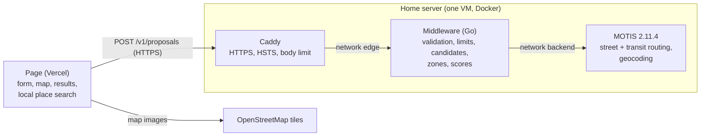

# Rendez-vous — target architecture and its decisions

The reference for how the service is being moved from the browser to a self-hosted server, and why each
choice was made. It records decisions as they are taken (from 2026-11-07); `docs/pipeline.md` describes
what runs today, and is updated as each part goes live. The machine itself (virtualization, firewalls,
remote access, backups) is documented in a private repository: this file only states what the service
needs from it.

## Status (2026-11-07)

| Part | State |
|---|---|
| Server reachable in HTTPS at `api.rendez-vous.gresset-bourgeois.fr` | Done: Caddy forwards `/v1/*` to the middleware (HSTS, 413 beyond 16 KB, 404 elsewhere); from 5G: ~50 ms to connect, ~200 ms for a first request |
| MOTIS (routing engine) on the server, not exposed | Done: tested from inside |
| Middleware (Go), `middleware/` | Skeleton deployed and tested from outside (2026-11-07): `GET /v1/health`, CORS, request log, image (4 MB to download) built by CI; `POST /v1/proposals` validates the question; the places file is loaded and checked at start-up (computation not written) |
| The page calling the middleware | Not started |
| Automatic timetable (GTFS) update | Designed, postponed: **needed before 2026-12-02** |
| Load test of the whole chain | To do once the middleware exists |

## Overview

Today all the logic runs in the browser, which calls openrouteservice, Transitous or Tisséo and the IGN
Géoplateforme directly (`docs/pipeline.md`). The target: the page sends one request with the
participants, the server does all the work and answers the proposals.



- **Page** (static, on Vercel): the form, the map, the results, and the instant local search of places
  (`data/pois-toulouse.json`). No routing, no scoring.
- **Caddy**: the only exposed component (TCP 443), terminates HTTPS with a Let's Encrypt certificate and
  forwards `/v1/*` to the middleware.
- **Middleware**: validates the request, applies the limits, picks candidates with the precomputed zones,
  calls MOTIS, computes both scores, answers.
- **MOTIS**: street times (walk, bike, car), transit journeys, geocoding; reachable only by the middleware.

## Decisions

Each entry: what was decided, the options considered, and why.

### All the logic leaves the browser (2026-11-07)

- Options: (A) a filtering relay in front of MOTIS, the page keeping candidates, zones and scores; (B) a
  middleware answering one request.
- Chosen: **B**. One network call instead of dozens (each ~35 ms from a phone on 4G), a single route to
  validate instead of part of the MOTIS API, and the target architecture already stated in `CLAUDE.md`.
  No progress streaming: the method by zones took ~0.2 s with a local MOTIS on a 16-core PC
  (`docs/evaluation.md`), so one answer is enough.
- Later, possible: sending each participant's position as soon as it is entered, so that part of the work
  is done before the button is pressed. It needs a session id, positions kept briefly in memory, and the
  visitor's consent (`legal.html`), since positions would leave before any click.

### The middleware is written in Go (2026-11-07)

- Options: JavaScript on Node (reuses `engine.js`, `debug-motis.js`, their tests and `scripts/eval`),
  Python (FastAPI and pydantic), Go, Rust.
- Chosen: **Go**. The middleware orchestrates more than it computes, so its speed matters little; Go gives
  a single static binary in a tiny image, an HTTP server and JSON in its standard library, strict types
  for validating input, and simple concurrency for the many parallel calls to MOTIS. JavaScript was ruled
  out by the author, who does not master it; rewriting also lets `scripts/eval` measure the deployed API.
- A home-made routing engine, if one is written, is a separate service in the language that suits it.

### Zones stay precomputed offline

`scripts/build-zones.js` builds them once (walking times from MOTIS) into the places file. The middleware
loads that file at start-up and only *uses* the zones at each request (estimate every zone, exact times
for the best, 3 distinct zones, then their places: `docs/evaluation.md` § Zones).

### Both scores from one computation (2026-11-07)

- The request carries **no score**: the costly part (street and transit times) is computed once, then both
  rankings (équitable, égalitaire) are derived, so switching score in the page needs no new computation.
- The zone shortlist depends on the score, so the exact times are computed for the **union** of each
  score's 20 best zones (expected to overlap largely: to measure on the evaluation groups).
- One of the two scores may be dropped later.

### API contract (2026-11-07)

`POST /v1/proposals` (versioned path, so the format can change without breaking open pages):

```json
{
  "meetingTime": "2026-11-09T19:00",
  "placeType": "bar",
  "participants": [
    { "lat": 43.6045, "lon": 1.4442, "modes": ["walk", "transit"], "people": 1 },
    { "lat": 43.5557, "lon": 1.4746, "modes": ["bike"], "people": 2 }
  ]
}
```

No string from the user is trusted: every field is typed, bounded or taken from a closed list, and anything
else is refused with a `400` carrying a fixed error code (`{"error": "invalid_time"}`), never echoing the input.
Implemented in `middleware/validate.go` (2026-11-07): the body must be `application/json` (so browsers always send a
preflight), is read through a 16 KB limit, decoded refusing unknown fields and anything after the first value, then
turned into typed values (time in Toulouse's zone, the time zone database built into the binary). Error codes:
`unsupported_media_type` (415), `body_too_large` (413), `invalid_json`, `invalid_time`, `time_out_of_range`,
`invalid_place_type`, `invalid_participants`, and, with `"participant": <index>` so that the page can point at the
card, `invalid_position`, `outside_area`, `invalid_modes`, `invalid_people` (400). A meeting time up to 15 min in the
past is accepted (the page offers the quarter hour already begun); until the end of the imported timetable is known,
at most 30 days ahead. Go's decoder matches field names regardless of case (`MEETINGTIME` is accepted): harmless,
the value still goes through the same checks. A valid question gets `501 not_implemented` until the computation exists.

| Field | Rule |
|---|---|
| `meetingTime` | Exactly `YYYY-MM-DDTHH:MM`, Toulouse time (the server handles daylight saving), minutes 00, 15, 30 or 45, between now and the end of the imported timetable |
| `placeType` | `station`, `bar`, `cafe` or `restaurant` |
| `participants` | 2 to 10 |
| `lat`, `lon` | Finite numbers inside the Tisséo area (the OpenStreetMap extract: longitude 1.10–1.72, latitude 43.32–43.85) |
| `modes` | Non-empty, no duplicate, among `walk`, `bike`, `car`, `transit` |
| `people` | Integer, 1 to 15 |
| Anything else | Unknown fields refused; body at most 16 KB |

The answer is complete (the page needs no file to show it) and indirect (a place ranked by both scores is
sent once):

```json
{
  "places": [
    { "name": "…", "category": "amenity=bar", "lat": 43.60, "lon": 1.44,
      "zone": { "name": "…", "others": ["…"] },
      "scores": { "equitable": 1520, "egalitaire": 1310 },
      "trips": [ { "participant": 0, "mode": "transit", "duration": 1260, "arrival": "…", "path": "…" } ] }
  ],
  "proposals": { "equitable": [0, 2, 1], "egalitaire": [0, 1, 3] },
  "data": { "gtfs": "2026-10-30", "places": "…" }
}
```

`proposals` holds indices into `places`. `data` gives the versions of the timetable and of the places file,
useful for the future report mode. Later: a second route giving the trips to another place of a zone, chosen
in the page (today its times are computed when it is chosen), with the same validation.

### Security of the API (2026-11-07)

The API is public: anyone can call it, not only the page. The threats considered: abuse (saturating the
machine), crafted input, leaking personal data (positions, IP addresses), a compromised container used to
reach further.

| Threat | Protection |
|---|---|
| Abuse by one client | **5 computations a minute and 100 a day** per client (a computation = one `POST /v1/proposals`, the whole chain), counted per IPv4 address and per **IPv6 /64** (one subscriber has a whole /64, so per address would be trivial to bypass); a `429` with the delay, shown as a clear message in French |
| Saturation, even by legitimate users | **At most 4 computations at once**; a request finding them busy waits up to ~5 s, then gets a `503` with a delay; timeouts on each computation and each MOTIS call. A daily ceiling for the whole service: to decide after the load test |
| Huge or slow requests | Body ≤ 16 KB (Caddy and Go), header read timeouts |
| Crafted input | The strict contract above; JSON decoding refusing unknown fields; errors expose nothing internal |
| Another site using visitors' browsers | CORS allowing only `https://rendez-vous.gresset-bourgeois.fr` (CORS protects visitors, not the server: `curl` ignores it) |
| Interception | HTTPS (TLS encrypts the path, query, headers and body; an observer sees only the IP addresses, the host name, timing and sizes), HSTS; positions sent by `POST`, so they never sit in URLs or access logs |
| Reaching MOTIS from the front | Two Docker networks: `edge` (Caddy–middleware) and `backend` (middleware–MOTIS); Caddy cannot reach MOTIS |
| A compromised container | Minimal image (the Go binary alone, no shell), non-root user, read-only file system, no Linux capability, memory limit |

- Logs: **no IP address and no position** (an IP address is personal data under the GDPR); only time, route,
  status, duration, number of participants and error code. IP addresses live in memory only, for the limits.
  May be revisited.
- Updates of the Docker images (Caddy, MOTIS, the middleware's base): by hand, monthly.
- Bypassing the per-client limit by changing IPv4 address needs real means (commercial VPNs, cloud machines,
  botnets); the global limits protect the machine whatever the number of addresses.
- The thresholds are starting values: they are to be set from a **load test** of the whole chain (response
  time, median and worst; CPU, memory, I/O and storage of each container), raising the number of
  simultaneous computations step by step (1, 2, 4, 8…) with requests drawn from the evaluation groups.

### Deployment of the middleware (2026-11-07)

- **Code in this repository**, in `middleware/` (excluded from the Vercel deployment). What the service is: the
  middleware (the intelligence: the engineering choices, zones, representatives), the server's backend (address
  completion, geocoding) and the interface, all designed for this service; they change together, so one repository
  and one CI. A home-made routing engine, if any, would live elsewhere (and the middleware might then move with it).
- **Image built by GitHub Actions**: tests, then build, then push to GHCR, tagged with the commit. The server only
  pulls: deploying is changing the tag in its `compose.yaml`, rolling back is putting the previous one. What runs is
  what was tested.
- **Data coupled to the code**: the places and zones file is built into the image. The algorithms were tested on given
  versions of the data, and that pairing is what is guaranteed. The image is built from the repository's root
  (`.dockerignore` keeps the context to `middleware/` and `data/pois-toulouse.json`), so a change of the file also rebuilds it.
  At start-up the middleware keeps only the candidates (bars, pubs, biergartens, cafés, restaurants, metro and bus
  stations), computes each zone's representative (its member closest to the zone's position, as `debug-motis.js`), and
  refuses to start on a broken file (zone index out of range, a bar without zone, a zone without place…). The answers'
  data version: the file's source dates and the first 12 digits of its SHA-256.
- Caddy kept in front, even for one service: it handles certificates (ACME), HTTP/2, and is the only exposed process,
  apart from the application (a restart or a crash of the middleware does not touch HTTPS), and other services will
  come. Go could serve TLS itself (`autocert`), at the cost of redoing all that.
- Caddy: HSTS, body ≤ 16 KB, `/v1/*` to the middleware on `edge`, 404 for the rest. The middleware: CORS (including
  the `OPTIONS` preflight), the client's IP from Caddy's `X-Forwarded-For` (trusted because only Caddy can reach it),
  a `-healthcheck` mode of its own binary for Docker (the image has no shell). First deployed with `/v1/health` only,
  to validate the whole chain (CI, image, server, Caddy) before the computation.
- Limits: the per-client quotas and the queue belong to the middleware, which knows what a computation costs and
  answers a precise error; Caddy's standard build has no rate limiting (a plugin means building and maintaining a
  custom Caddy). A coarse flood limit common to all services could be added to the proxy later.
- Latency (to do in the page): a `POST` with a JSON body triggers a CORS preflight (`OPTIONS`, one round trip),
  cached by `Access-Control-Max-Age` (browsers cap it: 2 h in Chrome, 24 h in Firefox). A new connection costs
  TCP + TLS (~150 ms measured from 4G, against ~35 ms on an open one). So the page warms the connection: a
  `GET /v1/health` once the form is in use (the connection then stays open for the click, and a server that is down is
  known before the click); `<link rel="preconnect">` alone does not last (unused sockets are closed after seconds).

### MOTIS on the server (2026-11-07)

- Image `ghcr.io/motis-project/motis:2.11.4`, the version of the local evaluation, so results stay comparable.
- Configuration of `docs/evaluation.md` (Tisséo GTFS, OpenStreetMap extract of the Tisséo area, 40 days,
  transfers walked on streets, `onetomany_max_many: 4000`), **plus geocoding and reverse geocoding**, for the
  measure below. No tiles, no web interface: only the API.
- The import (input files → routing data, ~123 MB) runs apart from the server, which reads only its result.
  `first_day: TODAY` makes the 40 days start at the import, so the import must be redone regularly even
  without a new GTFS.
- Measured at rest: ~77 MB of memory (its data is read from files on demand, through the system's cache).
- Timetable update (designed, postponed, needed before 2026-12-02 when the current GTFS ends): a nightly
  timer downloads the feed, checks it, imports into a `next` directory while the server runs on `current`,
  and only on success swaps them (keeping `previous` for a rollback) and restarts MOTIS; a failure changes
  nothing and is logged. To choose: nightly only when the feed changed or the last import is over 7 days
  old (recommended), or weekly always. OpenStreetMap by hand for now.

### Geocoding: IGN or MOTIS (2026-11-07, to measure)

- The instant local search of places stays in the browser (speed, tuned ranking: aliases, typos, metro first).
- To measure: MOTIS geocoding (OpenStreetMap addresses) against the IGN Géoplateforme on real addresses. If
  OSM's house numbers are good enough around Toulouse, IGN is dropped (one third party less; what is typed
  then goes to the author's server only). Its cost: one request to the server per keystroke for addresses,
  and no address completion when the server is down.

### No map tiles on the server (2026-11-07)

The page keeps loading OpenStreetMap's raster tiles from the visitor's browser (`js/map.js`). MOTIS's tiles
are vector tiles for its own interface (Leaflet would need a plugin), and serving them would add 0.5–2 MB
of traffic per visit through a home connection. OSM's tile usage policy is to check if the audience grows.

### Places per city, later

The places file is ~490 KB as served for the Toulouse area: fine in the browser. For other cities it may
grow too big: load one file per city, or move the search to the server (a request per keystroke). To decide
when a second city comes.

### What the service depends on

The home connection (Orange, public IPv4 not guaranteed fixed: a dynamic DNS record follows it), the domain's
DNS (OVH), Let's Encrypt for the certificate, Vercel for the page, OpenStreetMap for the tiles. Self-hosting
on a residential line: no contract clause found allowing or forbidding it; a non-commercial, low-traffic
service is assumed acceptable.
