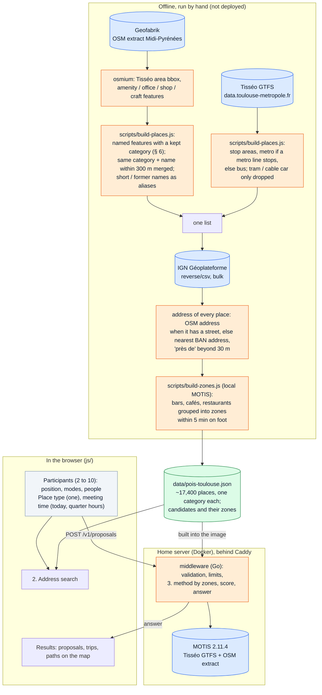
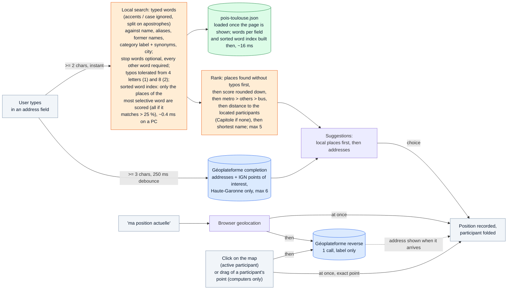
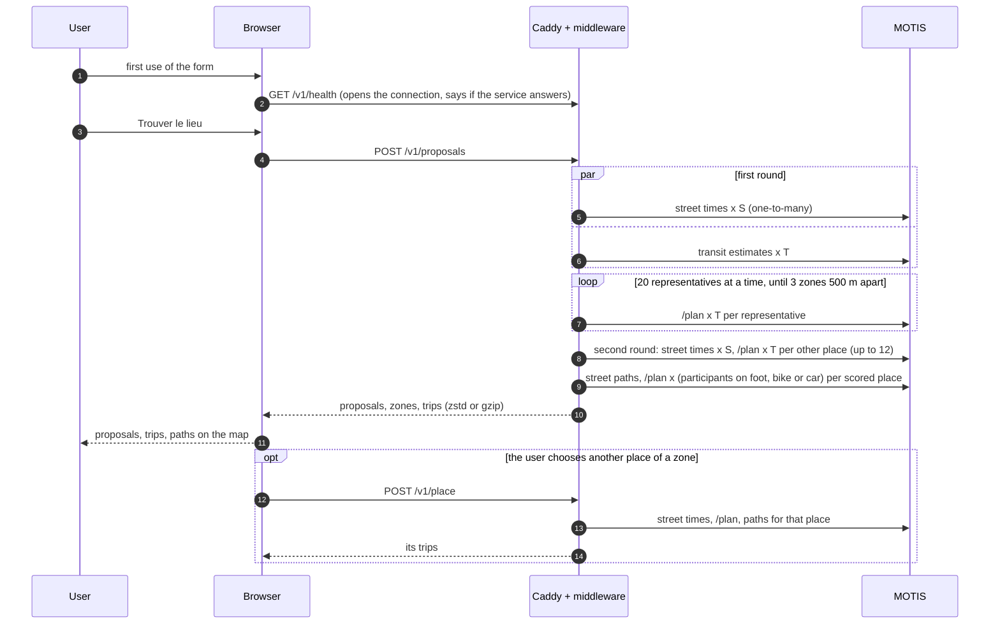

# Rendez-vous — processing pipeline

How the meeting point finder turns participants into proposed places. The page (`index.html`, `js/`, static, on Vercel)
collects the participants and asks **one question** to the service's API; the server (`middleware/`, Go, on the author's
home server, behind Caddy) computes with a self-hosted MOTIS and answers. Architecture, API contract and the reasons of
each choice: `docs/architecture.md`. No key, no settings and nothing stored in the browser.

Participants have no name field (removed 2026-10-29): they are "participant 1, 2…", with a color each,
shown as a disc in their color with their number (the label is kept for screen readers). The
proposals are numbered pins (map, legend, results), so that places and people do not look alike;
the chosen place is orange, and a pin without a number when it is not a proposal (another place of its
zone); the other places of the chosen place's zone are small grey pins.

People per participant (2026-10-29): after the modes, a chip (a person icon and 1) opening a
stepper − [n] +, folded again when the focus leaves it with one person (1 by default; the API accepts 1 to 15 and says so
beyond), for a team or a company leaving from one place with the same modes (people going another way: a second
participant at the same place). Every person counts as one in the mean time; the longest trip does not depend on the
people. Shown as ×n next to the participant's disc on the map and in their trip. 2 to 10 participants with a position.

One place type at a time (stations, bars, cafés or restaurants: one goes to a bar or to a restaurant, not to both), and a
meeting time among today's quarter hours. The results: the 3 proposals (each a zone's best place, with the zone as
context), each participant's trip as one line (mode, time, lines taken) and its steps folded under "Voir l'itinéraire"
(a click anywhere on the card folds or unfolds them), the paths on the map, and the zone's other places, folded, any of
them computed when chosen.

A change to a participant or to the place type makes the result stale, also during a computation: its call is cancelled
(`js/cancel.js`, one `AbortSignal`), nothing of it is shown. While the server computes (about 1 to 3.5 s), a line of text
says so. The API's refusals become messages in French (`js/api.js`): too many computations (with the wait), a busy
service, a computation too long, a time gone by, a participant outside the area, a service unavailable.

The diagrams are [Mermaid](https://mermaid.js.org/) code: GitHub renders them, and any
Mermaid editor (e.g. https://mermaid.live) can display or export them.

Legend used in the diagrams:

- **blue**: a call over the network
- **green**: local data (`data/pois-toulouse.json`)
- **orange**: algorithm choice
- **grey**: user input

## 1. Overview

## 2. Address search (search.js, geocode.js, autocomplete.js, participants.js)

Placing on the map: the *active* participant (highlighted card, named above the map) is the one
whose card was focused or touched last; at load, the first one. Once it is placed, by a suggestion,
"ma position actuelle" or the map, the next participant without a position becomes active, none if
all are placed, and none once the computation starts, so that a click on the result map moves
nobody. A single click waits 300 ms: a double click (or double tap) only zooms. Clicks on the
participants' and places' points do not reach the map. A participant's point is
a disc in their color with their number, as in their card (no permanent label). On computers
(`pointer: fine`), it can be dragged (by hand, written when it was a circle marker, which Leaflet
does not drag); not on touch screens, where it would fight with panning. The map does not recenter
after a map placement.

Score of a place (constants at the top of `search.js`, starting values to tune):

- each typed word keeps its best match over all fields: quality × field weight;
- quality: whole word 3 (also for an abbreviation: `st` = `saint`), start of a word 2, start of a
  word with typos 1 (see below), only when the place has no word equal to it or starting with it;
- weight: name 1, alias 0.8, category label or synonym 0.6, city 0.6, former name 0.3;
- + 2 when the name starts with the whole query, + 1 when every required word matches in the name;
- stop words (le, la, les, l, de, du, des, d, au, aux) add their match but may match nothing,
  unless the query has only stop words.

Sorted word index: every distinct word of every field (~11,300) with the places that have it,
built in the browser right after the data file. Shipping it precomputed would add ~100 KB
(brotli) to download, slower than building it below ~16 Mbit/s. A typed word finds its places by
binary search; only the places of the most selective required word are scored. Same results as
a scan of every place (checked on 830 queries); ~0.4 ms per keystroke on average on a PC instead
of ~3 ms, and never slower: a very common prefix (one letter, "to" for Toulouse) falls back to the scan.

Typos: a typed word of 4 letters or more may start a word with 1 typo, from 8 letters with 2 (a
letter replaced, added or removed, or two neighbouring letters swapped: optimal string alignment
distance to a start of the word, so that a word still being typed matches). Shorter words get
none: with 3 letters and 2 typos almost every word matches. Places matched only through a typo
come after every place found without one, whatever their score (otherwise "la cale" put "Les
Caves de la Maréchale" before "Le Cale Pain", the stop word adding its whole-word match). The
typo search walks the sorted word index as an implicit trie, with no extra memory but the number
of first letters each word shares with the next one (one byte per word): one row of distances
per letter, kept while the next words share the letters, and every word sharing a start skipped
once that start decides. Measured 2026-10-30 on a PC over 1,000 typed words with one random typo:
0.08 ms per word (0.5 ms at worst) with 1 typo, 0.27 ms (1.3 ms) with 2; same words as a distance
computed over every word (400 checks); a keystroke costs ~0.3 ms more on average. About 30 words
and 250 places per typed word with 1 typo, 480 and 3,800 with 2, hence the thresholds. Measured
earlier (2026-10-29, bench not kept): counting a swap as one typo catches 13 % more typos for the
same cost; a deletion index (SymSpell) would take 24–32 MB and 0.2–0.6 s to build, for 0.1 ms
less. Not done: phonetic matching ("jores" for "jaures", two typos at 5 letters; declined).

## 3. Computation (middleware/zones.go)

```mermaid
flowchart TB
    classDef api fill:#DBEAFE,stroke:#2563EB,color:#0C1A2E
    classDef local fill:#DCFCE7,stroke:#15803D,color:#0C1A2E
    classDef algo fill:#FFEDD5,stroke:#EA580C,color:#0C1A2E

    START(["Question: participants, place type, meeting time T"]) --> VALID["Validation (validate.go): types, bounds,<br/>Tisséo area, quarter hours; then the limits<br/>per client and for the service (limits.go)"]:::algo
    VALID --> GROUPS["Groups: the zones of the place type<br/>(each with its representative), or every station alone"]:::algo
    DATA[("pois-toulouse.json<br/>loaded at start-up")]:::local --> GROUPS

    subgraph FIRST["First round: every representative estimated"]
        STREET[("Street times: one-to-many<br/>1 call per participant and street mode<br/>(+ walk, 15 min at most, for transit without walk);<br/>car + 5 min to park")]:::api
        EST[("Transit estimate: one-to-many-intermodal<br/>1 forward search per transit participant,<br/>leaving T − 60 min")]:::api
    end
    GROUPS --> FIRST
    FIRST --> RANK1["Each participant's fastest mode,<br/>score, ranking"]:::algo

    RANK1 --> EXACT[("Exact transit: /plan for the 20 best,<br/>arriving by T + 10 min, 5 itineraries;<br/>shortest time from leaving to T or arrival,<br/>then latest departure")]:::api
    EXACT --> KEEP["Keep the 3 best groups at least 500 m apart;<br/>fewer: 20 more exact, again"]:::algo

    KEEP --> SECOND[("Second round: up to 4 other places per kept zone,<br/>farthest first; street times and exact transit")]:::api
    SECOND --> FINAL["Score = (mean per person + longest) / 2;<br/>zones best first by their best place"]:::algo
    FINAL --> PATHS[("Street paths of every scored place:<br/>/plan with a street mode, 1 per participant on foot, bike or car")]:::api
    PATHS --> ANSWER["Answer: proposals, zones (their places,<br/>the others without times), each trip with its legs"]:::algo

    ANSWER -.->|"the visitor chooses another place of a zone"| PLACE["POST /v1/place: that place's street times,<br/>exact transit, score, paths"]:::algo
```

Times of the whole computation, measured on a 16-core PC with MOTIS local (3 or 4 participants, walk + transit): bars
~1 s, restaurants ~2 s, stations ~3.3 s, the estimate being most of it (`docs/architecture.md` § The method by zones);
from outside on the server: 1.6 to 3.5 s with the network, another place 0.2 s.

## 4. Calls of one computation

With `P` participants, `S` the street calls (each participant's street modes, plus one walk for a transit participant
without walking) and `T` participants who may take transit:

| Call | Per computation | Limit |
|---|---|---|
| `GET /v1/health` | once per page, at the first use of the form | not logged when it answers |
| `POST /v1/proposals` | 1 | per client 5 a minute and 100 a day (IPv4 address or IPv6 /64); 4 computations at once for the service |
| `POST /v1/place` | 1 per other place of a zone chosen | per client 30 a minute and 300 a day |
| MOTIS (from the middleware only) | `S` + `T` + 20 to 40 × `T` + up to 12 × (`S` + `T`) + up to 15 × `P` | 6 calls at once, 10 s each, the computation 25 s |
| Géoplateforme completion | 1 per pause while typing (≥ 3 chars) | none stated |
| Géoplateforme reverse | 1 per "ma position actuelle", map click or drag of a point | none stated |

A computation's answer weighs 8 to 220 KB raw, 3 to 19 KB compressed (measured 2026-11-08). `detailedTransfers=true`: the
map also draws the walks between two lines.

Links of the chosen place (no call until followed): its OpenStreetMap page (`openstreetmap.org/node/…`
for an OSM feature, a marker at its position for a Tisséo stop) and a Google Maps search (name and
address, so that Google shows the place's own page; position for a stop). "Partager le lieu" sends
name, address, meeting time and the OpenStreetMap link to the system share sheet (`navigator.share`), or
copies them to the clipboard where there is none (most computers).

## 5. Data sources and licences

| Data | Source | Licence / policy |
|---|---|---|
| Bars, restaurants, companies, shops, schools… | OpenStreetMap via Geofabrik, data of 2026-10-27 | ODbL |
| Metro stations, bus stops | Tisséo GTFS, 2026-10-28 | ODbL |
| Place addresses | OpenStreetMap, else IGN Géoplateforme (Base Adresse Nationale), 2026-10-28 | ODbL / Licence Ouverte |
| Walk, bike, car, transit | the author's MOTIS on the Tisséo GTFS and an OpenStreetMap extract | ODbL |
| Map tiles | OpenStreetMap | tile usage policy |

## 6. Place categories

To rebuild the file from scratch (OSM download, osmium, Tisséo GTFS, addresses, every
post-processing step below): `scripts/regenerate-places.sh` (needs curl, osmium-tool, node,
unzip; `--pbf` reuses an extract already downloaded). About 30 s plus the ~360 MB download.

Every place of `data/pois-toulouse.json` has exactly one `category` code; the French label of
each code is in the file's `categories` table. The code depends on where the place comes from
(`scripts/build-places.js`, "CATEGORY RULES"):

| Source | How the code is set | Examples |
|---|---|---|
| Tisséo GTFS stop area | `metro` if at least one metro trip stops at one of its stop points, else `bus` if a bus trip does; stop areas served only by tram or cable car are left out | `metro`, `bus` |
| OpenStreetMap feature with a `name` | the first tag present among `amenity`, `office`, `shop`, `craft` (in this order) that is kept, written `key=value` | `amenity=bar`, `office=company`, `shop=bakery` |

OSM tags kept:

- `amenity`: only a listed set of values people look for by name (bar, restaurant, school,
  pharmacy, bank, café, town hall, cinema…); benches, lockers, chargers… are dropped, and the
  next key is tried.
- `office`, `shop`, `craft`: every value except `shop=vacant`.

Labels: a listed code gets its own label (`office=company` → "entreprise"); an unlisted
`office`, `shop` or `craft` value gets the key's label ("bureau", "commerce", "artisan").
The code always keeps the precise OSM tag, so a label can be refined later without
regenerating the file's codes.

Candidates: the service only proposes `amenity=bar`, `pub`, `biergarten` (the page's "bars"), `amenity=cafe` ("cafés"),
`amenity=restaurant`, `metro` and `bus` places (`placeCategories` in `middleware/data.go`); every other place is for the
address search only. Only candidates keep their OSM or GTFS `id` (the API names a place by it); the ids of the other
places would weigh a quarter of the file.

Duplicates: within one source, the same name (accents and case ignored) closer than 300 m is
one place, whatever its categories: it takes the category first in the order bar, restaurant,
metro, bus, other amenities, office, shop, craft, and the position and address of its best
described feature (an address, then a node rather than a building). An OSM `amenity=bus_station`
named like a Tisséo stop area within 300 m is that stop area and is dropped. Other OSM places
named like a nearby stop (a school, a church, a clinic) stay apart: the stop is named after them.

Fields (generation normalizes them, the browser only reads them):

| Field | Presence | Content |
|---|---|---|
| `id` | candidates only | OSM `node/…`, `way/…`, `relation/…` or Tisséo `stop_area:…` |
| `category` | always | code, see above |
| `name` | always | as written in OSM or the GTFS, trimmed only (capitals are often real acronyms) |
| `lat`, `lon` | always | node, mean of a building's outer ring, or stop area position; 5 decimals |
| `street` | ~17,200 | house number and street, street type capitalized |
| `postcode`, `city` | all but 2 | commune in its BAN spelling, without CEDEX; CEDEX or missing OSM postcodes replaced by the BAN one |
| `addrSrc` | with an address | index in the top-level `addressSources` table (`["osm", "ban"]`), not read by the page. `osm`: the place's own OSM street; `ban`: the nearest BAN address (bulk reverse geocoder), or, when none is found, only the postcode and city of the nearest one within 500 m (no street) |
| `near` | some `ban` | the BAN address is more than 30 m away ("près de") |
| `aliases` | ~700 | OSM `short_name`, `alt_name`, `official_name` (split on `;`) |
| `oldNames` | ~140 | OSM `old_name`, kept apart: it sometimes names the previous business at the address |
| `zone` | bars, cafés, restaurants | index in the top-level `zones` table |

Zones (`scripts/build-zones.js`, last step of the regeneration, needs a local MOTIS; alone: ~20 s), one
kind at a time (bars, cafés, restaurants): complete linkage, so that no two places of a zone are more than 5 min apart on foot, either
way, with MOTIS's walking times (no chaining: it runs away, `docs/evaluation.md` § Clusters); lone
places are zones of one. Top-level `zones`: `[{ kind, name, lat, lon }]`, the position of the representative,
the place closest to the zone's centroid. Names, automatic: a lone place's own name; otherwise the metro station or bus stop closest
to the representative; several zones on one stop: the closest to it keeps the name, the others
take their most represented street not taken yet (ties in alphabetical order), else the stop and a number.
161 zones of bars (36 of 3 places or more, 21 of 2, 104 of 1; largest 12), 109 of cafés (31, 17, 61; 15),
581 of restaurants (153, 124, 304; 31). Used by the service (`middleware/zones.go`, § 3): the middleware loads the file
at start-up, keeps the candidates, and refuses to start on an inconsistent one. Within a zone kept, 5 places get exact
times: the representative, then each time the place farthest from those picked, as the crow flies (the distance to a
set being the one to its closest member; `docs/evaluation.md` § A maximum of places). The others are listed without a
time: choosing one asks `POST /v1/place`, without changing the proposals.
